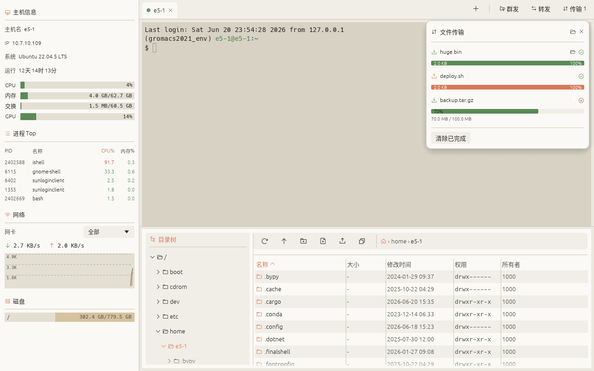
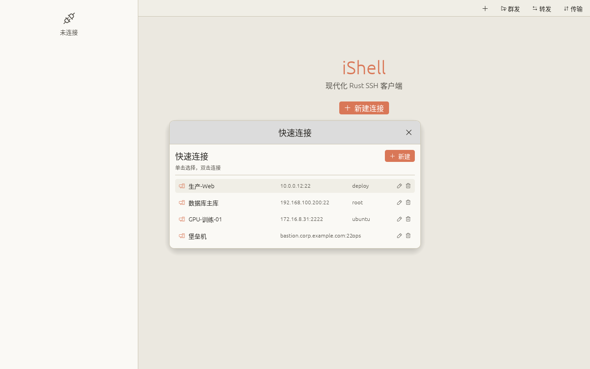
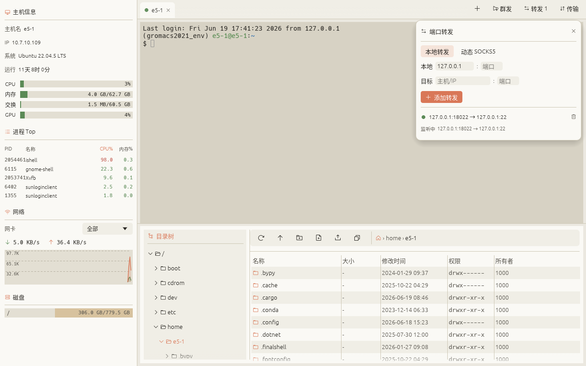
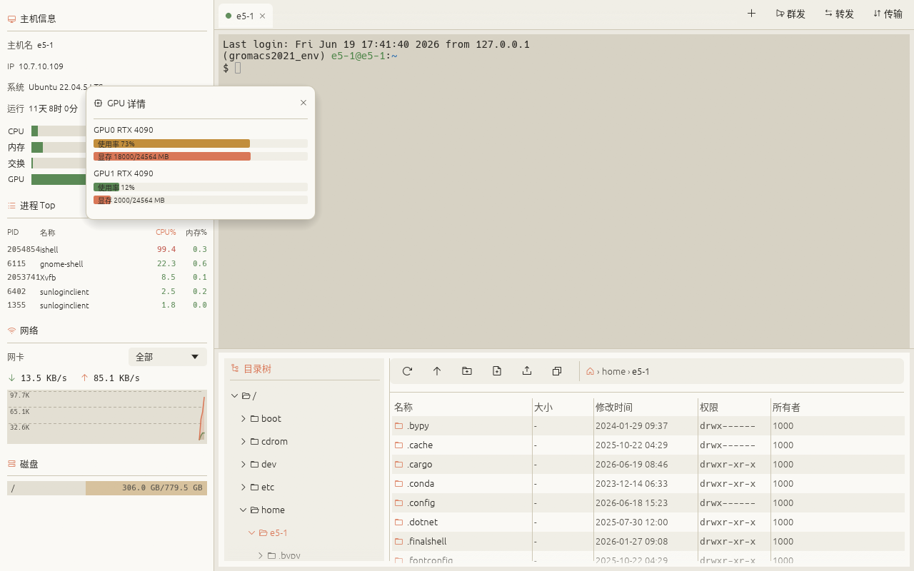
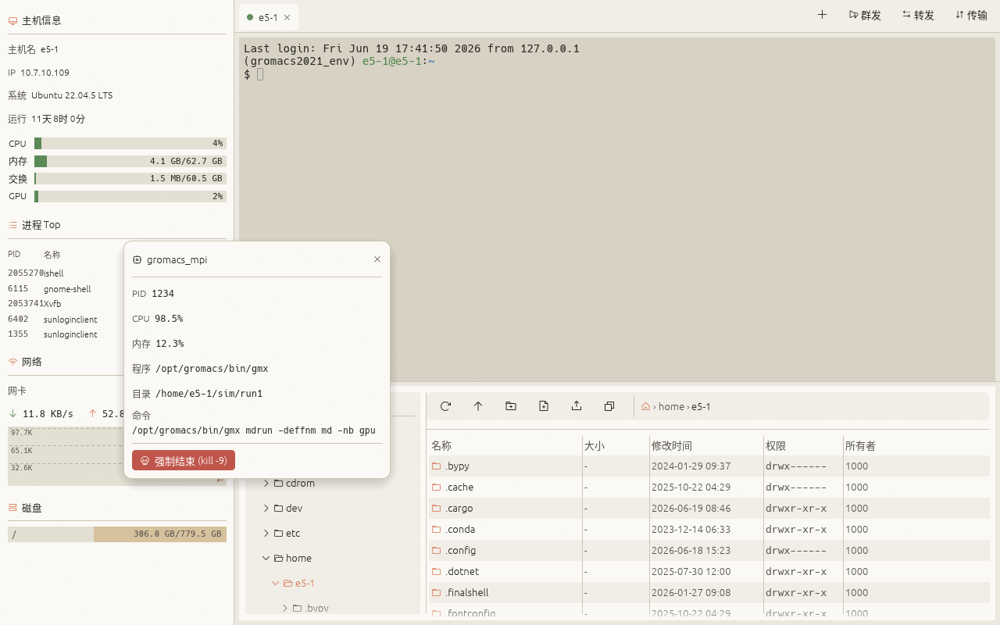
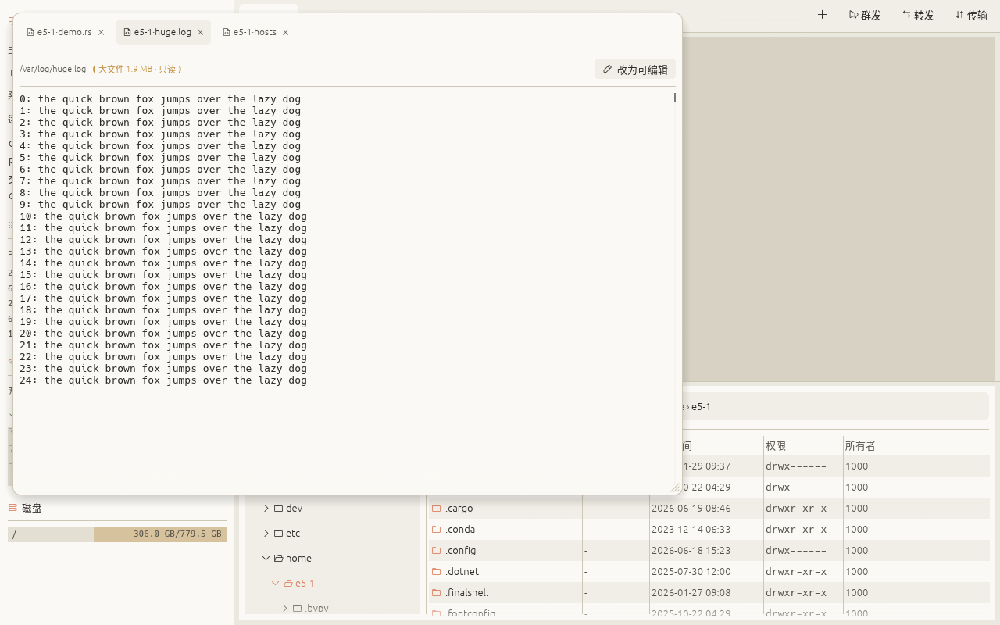

<div align="center">


**A modern, AI-native SSH terminal written in Rust**

Let Claude Code, Codex CLI, Kimi Code, OpenCode, or another MCP-compatible agent drive a real, persistent terminal session — plus system monitor · SFTP file manager · port forwarding · jump hosts, all in one window

**English** · [中文](README.zh-CN.md)

[](https://github.com/wqkx/ishell/releases)


> **Latest release:** [v0.28.0](https://github.com/wqkx/ishell/releases/tag/v0.28.0)

</div>

## Why iShell

Everything you need for daily SSH work in **one window** — and it stays out of your way.

- 🤖 **Let AI drive the terminal (MCP)** — Claude Code, Codex CLI, Kimi Code, and OpenCode operate a real persistent session (cwd/env/history intact); commands appear live in the tab. On by default (Settings turns it off); the matching proxy binary ships inside iShell and installs onto a server in one click. An AI only ever reaches the iShell of the terminal it was started in, so several computers can share one AI server. See "AI / MCP integration".
- ⚡ **Fast & lightweight** — pure Rust + GPU immediate-mode UI. A single binary (~8–12 MB), instant startup, **~0% idle CPU**, **~80 MB RAM**. No Electron / JVM / Python, no daemon, no runtime deps.
- 🎯 **Refined user experience** — a clean, warm light theme; smooth drag-to-reorder tabs; no toolbar clutter; English / 中文 switchable on the fly; sensible defaults so it just works.
- 📁 **Effortless file operations** — multi-select rubber-band, batch delete/download, server-side copy/move, **resumable** transfers that **auto-resume after reconnect**, and folder **compress-download** (tar.gz) for thousands of small files.
- 🔗 **Terminal ↔ files, linked** — "open this dir in terminal" from the file list, "reveal the terminal's current dir in the file list" the other way, and the working directory is **restored on reconnect** (OSC 7).
- 🧰 **Complete feature set** — agent auth & forwarding, jump hosts, port forwarding + SOCKS5, command broadcast & snippets, live CPU/GPU/net/disk/process monitoring with `kill -9`.
- ✍️ **A genuinely powerful editor** — a virtualized code editor that opens in its own window: **multi-cursor (Ctrl+D)**, syntax highlighting, find & replace, encoding/EOL auto-detect, Chinese IME, and it stays fast on huge files.

## ⚙️ Footprint

| Metric | Value |
|---|---|
| Binary | single file, no runtime deps / daemon — **Linux ~12 MB · macOS ~8–9 MB · Windows ~10 MB** (size-optimized: opt-level `s` + fat LTO + strip) |
| Idle CPU | **≈ 0%** (one idle session; system info polled every 2 s) |
| Memory | **~80 MB** (idle, measured) — native app, **no Electron / JVM / Python** runtime; far below Electron-based clients that idle at hundreds of MB |

> Measured on Linux, release build, one idle session; varies slightly with GPU driver / resolution.

## 🚀 Features

**AI / MCP integration** (on by default — see "AI / MCP integration" below)
- Let Claude Code, Codex CLI, Kimi Code, and OpenCode drive a **real terminal session** (cwd/env/history intact), with live commands and output
- Full tool set: run commands, read screen/history, interactive input, interrupt, open/close sessions, read/write/transfer remote files
- SSH reverse-forward lets the AI on a remote server reach back to this iShell; **an AI started in a terminal can only reach that terminal's iShell, so several computers can safely share one AI server** (see below)

**Connections & sessions**
- Multi-session tabs: status dots, **smooth drag-to-reorder animation**, overflow fade, close confirmation
- **Authentication**: password, key file, **SSH agent** (`SSH_AUTH_SOCK` / Windows OpenSSH pipe), or **keyboard-interactive (OTP / 2FA)**
- **Agent forwarding (`-A`)**: let remote processes reuse your local ssh-agent keys (no re-auth across hops)
- **Import `~/.ssh/config`** (pick which hosts; Host / HostName / User / Port / IdentityFile / ProxyJump)
- **Groups / tags / search** for saved connections
- Saved-password key stored in the **OS keychain** (Secret Service / Keychain / Credential Manager), with an encrypted-file fallback
- **Auto-reconnect** on drop (exponential backoff) + manual reconnect; **restores working dir** (OSC 7) on reconnect
- **Host-key verification** (known_hosts + trust-on-first-use, anti-MITM)

**Terminal**
- vt100 / 256-color, scrollback, Tab completion, focus locking
- **Selection copy / right-click copy & paste / Ctrl+Shift+C·V**, **Ctrl+scroll to resize font**
- **Clickable URLs**, **ERROR/WARN keyword highlighting**, **session logging** to file
- **Content search** (Ctrl+Shift+F, full scrollback, match highlighting)
- **Prefix + Up/Down** per-session history search
- Dark / light terminal toggle; full CJK / IME input

**Terminal ↔ files integration**
- **File list → terminal**: right-click a folder → "Open in terminal" (or "Open current dir in terminal") `cd`s that session there
- **Terminal → file list**: right-click the terminal → "Show current dir in the file list" jumps the SFTP panel to the shell's current directory (via OSC 7, with a one-time consent prompt if the shell doesn't emit it)
- **Working dir restored on reconnect**, so a dropped session comes back where you left it

**Tunneling & batch**
- **Port forwarding**: local forward + dynamic SOCKS5 proxy
- **Jump host / ProxyJump**: reach internal targets through a bastion
- **Command broadcast**: send a command to every connected session at once
- **Command snippets**: save frequent commands, send to the current session terminal in one click (optional auto-Enter), persisted

**Files & transfers**
- SFTP: tree + list, **name filter**, **click a header to sort by name / size / time** (size & time default to descending), drag-and-drop upload, chmod / rename / copy path, optional default download folder
- **Multi-select batch ops**: Ctrl/Shift + rubber-band select; **batch delete** (Delete key / toolbar, recursive for folders), **batch download**
- **Remote copy / move**: right-click "Copy / Cut" + "Paste here", done entirely on the server (multi-select, recursive)
- **Resumable downloads**: chunk-bitmap resume bound to remote size+mtime, auto-retry on transient errors and **auto-resume after reconnect**; transfers can be cancelled or retried (no manual pause)
- **Folder compress-download**: tar.gz on the server, single-file parallel download, pure-Rust unpack — fast for many small files
- **Concurrent transfers** (up to 6 per server; independent across servers), cancellable mid-transfer
- **Lightweight image viewer** (its own OS window): double-click a `png / jpg / gif / bmp` — zoom / pan / fit / 1:1 / save-as

**Built-in code editor** (its own OS window, tabbed)
- **Unified virtualized editor** — renders only the visible lines, so even huge files open instantly and stay smooth at low memory; every file uses the same full-featured editor
- **Multi-cursor (Ctrl+D)** — accumulate selections of the same word, then **type / delete / move them all at once** (VS Code-style)
- **Syntax highlighting**, current-line highlight, **bracket matching**, indent guides, auto-close brackets
- **Find & replace** (regex / case / whole-word, match highlighting), **Go to line** (Ctrl+G), word & document navigation
- **Comment toggle**, duplicate / move / delete line, undo / redo
- **Encoding auto-detect** (UTF-8 / GBK / … via chardetng) and **EOL (LF / CRLF)** detection — both **clickable in the status bar to switch**, with safe re-encoding on save
- **External-change detection** — guards against overwriting a file edited on the server since you opened it
- Full **Chinese IME** input, double-click word select, fixed line-number gutter, download-progress tabs

**Monitoring**
- Live monitor: CPU / memory / swap, **GPU (NVIDIA / AMD / Intel)**, network graph, disks, top processes (click for details + kill -9)

## 📸 Screenshots

| SFTP file manager + concurrent transfers |
|---|
|  |

| Quick Connect | Port Forwarding |
|---|---|
|  |  |

| GPU details | Process details + kill -9 |
|---|---|
|  |  |

| Code editor — multi-cursor, syntax highlighting, find & replace, opens in its own window |
|---|
|  |

## 📦 Install

Download the archive for your platform from [**Releases**](https://github.com/wqkx/ishell/releases) (releases ship archives only, no bare binaries):

| Platform | File |
|---|---|
| Linux x86_64 | `ishell-linux-x86_64.tar.gz` |
| Linux ARM64 | `ishell-linux-aarch64.tar.gz` |
| macOS Apple Silicon | `ishell-macos-aarch64.app.zip` |
| macOS Intel | `ishell-macos-x86_64.app.zip` |
| Windows x86_64 | `ishell-windows-x86_64.zip` |

```bash
# Linux: extracts to iShell/ (with icon, .desktop and an install script)
tar xzf ishell-linux-x86_64.tar.gz && cd iShell && ./ishell

# macOS: extracts iShell.app — drag to Applications or launch from Finder
unzip ishell-macos-aarch64.app.zip

# Windows: extract ishell.exe and run it
```

- **macOS** (unsigned, first run): `xattr -dr com.apple.quarantine iShell.app`, or "System Settings → Privacy & Security → Open Anyway".
- **Windows** SmartScreen: click "More info → Run anyway".

## ❓ Troubleshooting

**Chinese/IME (fcitx/ibus) won't type on Linux Wayland?**
Some Wayland desktops (KDE Plasma / GNOME) have flaky `text-input-v3` support for winit-based apps, so fcitx-style IMEs never activate or compose (same issue as Chrome/Electron). Fix: **switch to X11 (XWayland)**, where XIM input works. Two ways (either one):

- **In-app**: right-click the terminal → check "**Force X11 (fix IME · restart)**" → **restart iShell**. The setting is persisted — set it once.
- **Env var**: `ISHELL_X11=1 ./iShell/ishell` (or temporarily `WAYLAND_DISPLAY= ./iShell/ishell`).

> Trade-off: forcing X11 loses some native-Wayland niceties (e.g. smoother fractional scaling) in exchange for a working IME — the same trade-off as Chrome's `--ozone-platform=x11`. The default is still Wayland; it only switches when you enable this.

**The whole UI freezes while typing with fcitx (often over a remote desktop)?**
Uncheck **“IME candidate window follows the caret”** (Settings → Startup). Takes effect immediately, no restart.

Why: telling the IME where the caret is means a **synchronous XIM request** on X11 (`XSetICValues`), and Xlib waits for the reply **with no timeout** — on the very thread that draws the UI. If the IME dies mid-request (crash, restart, remote-desktop session switch/reconnect) that thread is stuck for good. A captured stack looks like:

```text
poll(timeout=-1) → _XReadEvents → XIfEvent → _XimRead → XSetICValues
                 → winit::…::ImeContext::set_spot → eframe::run_native
```

winit only sends that request when the coordinate actually *changes*, so reporting a constant one means it is never sent at all. You keep full CJK input; the candidate window just stops following the caret. iShell also detects a frozen UI thread on its own and appends an explanation to `~/.config/ishell/crash.log` — it only reports, it never changes settings behind your back.

**Whole UI looks suspended after minimizing the window — and the AI can't drive it either?**
Fixed in 0.24.x: Wayland disables vsync by default, and a local eframe patch keeps the event loop alive for hidden surfaces (prefer compositor `request_redraw`, fall back to direct paint after ~100 ms if `RedrawRequested` never arrives; skip `swap_buffers` when minimize is detectable). You usually don't need an env var.

If it still happens: make sure `ISHELL_VSYNC=1` is not set; on X11 try `ISHELL_NO_VSYNC=1`.

A zero-cost way to tell (no gdb needed): **type something → minimize → wait 15s → restore → read `~/.config/ishell/crash.log`**.
- There's an entry (saying the window was minimized/occluded) → only the UI thread was blocked, the process is alive.
- Nothing logged, yet the AI really couldn't drive it → even the watchdog thread was frozen, so something outside iShell is suspending the whole process.


## 🔧 Build from source

Requires [Rust](https://rustup.rs/) (stable). On the target platform:

```bash
cargo run --release
```

See [BUILD.md](BUILD.md) for per-platform details, dependencies, and cross builds.

## 🏗 Architecture

- The **frontend (egui, synchronous immediate mode)** and the **backend (tokio SSH worker, async)** are decoupled via channels.
- Each session = one independent worker task: an interactive shell channel, an SFTP channel, and a system-info probe every 2 s.
- The terminal keeps its screen model in `vt100`; egui renders it line-by-line with per-span color, and keyboard events are encoded back as ANSI sequences.
- The code editor renders only visible lines over a virtualized scroll area, so file size barely affects memory or latency.

| Concern | Choice |
|---|---|
| GUI | `eframe` / `egui` 0.34 |
| SSH / SFTP | `russh` 0.61 (ring backend) / `russh-sftp` 2.3 |
| Terminal | `vt100` 0.16 |
| Async | `tokio` |
| Encrypted storage | `chacha20poly1305` |

## 🤖 AI / MCP integration

Let an AI (Claude Code, Codex CLI, Kimi Code, or OpenCode) drive a **real, persistent** terminal session — cwd / env / history intact — instead of a throwaway `ssh host cmd`. These four MCP clients have been tested with iShell. It can take over a tab you already have open, or open a read-only AI-only session from a saved connection (a human can't type into it).

### Enable & setup

1. **On by default** since 0.19 (it was opt-in before). Settings → “Allow AI to control terminal via MCP” turns it off. Listens only on a local Unix socket (`~/.config/ishell/mcp-<pid>.sock`, mode `0600`) — no network port. Changing the switch needs a restart.
2. Install the proxy on the machine that runs the AI:
   - **AI runs on a server you SSH into** — right-click in that server's terminal → **“Install the AI control agent on this server”**. iShell ships a matching `ishell-mcp` inside itself and pushes it over the existing SFTP channel to `~/.ishell-mcp/bin/ishell-mcp`, then types the register command into the terminal for you. Versions match by construction, so “version mismatch, redeploy” cannot happen. *Release builds embed the agent only on Linux, and only for the build's own architecture* (a Linux x86_64 iShell can deploy to x86_64 Linux servers); the menu item is hidden when this build embeds nothing. A build that embeds several architectures is possible — see BUILD.md.
   - **AI runs on this computer, or the server is another arch** — install by hand: download `ishell-mcp-<platform>.tar.gz` from Releases (`.zip` on macOS), extract `ishell-mcp`, then:
     ```bash
     scripts/install-mcp.sh ./ishell-mcp                  # → ~/.ishell-mcp/bin/ishell-mcp
     claude mcp add ishell -s user -- ~/.ishell-mcp/bin/ishell-mcp   # Claude Code
     # Claude Code, Kimi Code, and OpenCode: register the stdio server using the client’s MCP settings.
     ```
     **Codex CLI:** add the server to `~/.codex/config.toml` (or the applicable Codex config):
     ```toml
     [mcp_servers.ishell]
     command = "/home/you/.ishell-mcp/bin/ishell-mcp"
     ```
     and start Codex from an iShell terminal **with `codex --no-daemon`** (e.g. `alias codex='codex --no-daemon'`). By default Codex runs agents inside a shared background server (`codex app-server`, long-lived, with no terminal); MCP proxies spawned by that server are not descendants of your terminal, so iShell cannot tell which terminal they belong to and they are refused. No environment variables are involved any more — nothing to forward or hard-code. For Claude Code, Kimi Code, and OpenCode, register the stdio server with the same `ishell-mcp` command; other MCP clients can do the same. The GUI and `ishell-mcp` **must be the same version**; re-run the install script after upgrading.

### Tools

| Tool | Purpose |
|------|---------|
| `list_sessions` / `list_saved_connections` | Open sessions / saved connections |
| `open_session` / `close_session` | Open/close an AI-only read-only session |
| `run_command` / `poll_run` / `start_command` | Run & wait / keep waiting / start long jobs (up to 24h) |
| `send_input` / `interrupt` | Interactive input; Ctrl+C (also frees a stuck pending command) |
| `read_screen` / `read_history` | Visible screen / full scrollback |
| `write_file` / `read_file` | Small text inlined over JSON (don't use for large files) |
| `copy_to_remote` / `copy_from_remote` | Streaming single-file transfer (bytes stay out of MCP JSON); `local_path` is on the **ishell-mcp host** |
| `copy_between_sessions` | Copy a single file between two open remote sessions |

### How an AI finds your iShell (and why it can never reach another one)

With the switch on, each SSH connect reverse-forwards the local MCP socket to a **random, per-connection** path `~/.ishell-mcp/mcp-<nonce>.sock` on that server (same encrypted channel, no extra port). iShell then **registers the connection's login shell** on the server: it writes `~/.ishell-mcp/sess/<host>/<shell pid>` (mode `0600`) containing that socket path, a random key generated when *this run* of iShell started (memory only, never written on your computer), and the shell's pid and start time. Nothing is typed into your terminal; it works however fast you start typing.

`ishell-mcp` walks up its own **parent processes** and uses the first ancestor that has a valid registration file (right pid, matching start time, owned by you, not group/world accessible). It then connects to **exactly that endpoint and nothing else** — it never lists directories, probes neighbours, pops up a chooser, or falls back to anything. Which terminal you are a descendant of is a fact the kernel gives, not something an environment variable can claim. The rules, with no exceptions:

1. **Not a descendant of a registered login shell → refused.** That includes agents run by an IDE, a systemd service, tmux/screen (their processes hang off the multiplexer, not the login shell), or Codex's shared background server. The error says why and what to do; there is no manual configuration, no “copy pairing config”.
2. **Wrong or stale registration → refused, silently.** The endpoint only answers a peer that proves it holds the key (HMAC challenge–response; the key never goes over the wire, and the proxy proves itself only after the iShell has proved itself). An iShell answers an unauthenticated caller with **zero bytes** — not even its version or host name.
3. **Restarting iShell invalidates every running agent.** The key is per run, so agents started before the restart can no longer connect; start them again from the terminal. The same goes for an SSH reconnect (new shell, new registration).
4. **No degradation.** A dead endpoint is an error, never “try the next one”.
5. **Registration results are inspectable.** If the registration script fails on the server, the session status bar and a toast say “MCP registration failed …”. A server that refuses the reverse forward, or an undetectable remote `$HOME`, is explained in the status bar only (no toast); AI control being off at launch (turning it on needs a restart) is silent. In all of these `list_sessions` reports `bound: false` and the agent-side error carries diagnostics.

So with computers B and C both connected to one AI server account, an agent started in B's terminal can only ever reach B's iShell, and C never sees a byte from it. Works on Linux and macOS servers (it only needs POSIX `ps`) and for iShell's own “local” terminals on Linux and macOS; Windows has no MCP. The macOS paths are compile-checked but have not been run on a Mac. If an agent says it cannot find a terminal, its error lists the process ancestry it saw; the same goes to `~/.ishell-mcp/diag.log`.

Known limits, stated plainly:

- **Same-account visibility.** The registration files are `0600`, but everyone sharing the server account is the same Unix user, so anyone logged in as that account can read them (as they could read an environment variable through `/proc`). They die with the iShell run / the SSH connection. Nothing sensitive goes into your shell history any more.
- **`ls ~/.ishell-mcp/` shows every forwarded socket** (including other computers'). The proxy never looks; a person can.
- **Agents inside one iShell are not isolated from each other.** The “only sessions it opened itself” rule relies on each agent declaring who it is; an agent that lies can touch a sibling agent's sessions *on the same iShell*. It cannot reach another computer.

**Anyone who can SSH into that server (same account) can reach the forwarded socket — enable only for servers you trust.** But reaching it is not enough: they get no answer without the run key, and an AI can only read and act in sessions it opened itself — sessions *you* opened are invisible and off-limits to it.

### Local API (for programs on this computer)

Besides MCP, iShell can expose an HTTP+JSON API on the **loopback interface** so other programs on your desktop — local AI agents in particular — can drive it with the same capabilities, without being started from an iShell terminal and without an MCP client.

- **The switch is the “Local API” button at the bottom of the left panel**; it is **off by default** and independent of the MCP switch. When on, the address and a per-enable random token are written to `~/.config/ishell/api.json` (0600) for callers to read.
- It binds `127.0.0.1:47621` only (if the port is taken it says so and fails — no fallback port); web pages in a browser cannot reach it (`Host` check, requests carrying `Origin` are refused, no CORS headers).
- Same rule as MCP: **a caller can only read and act in sessions it opened itself**; callers name themselves with `X-Ishell-Actor`, which can never equal an MCP proxy's identity.
- The only gate is the token: any same-user process on this machine that can read `api.json` can use it — enable it only if you trust the other programs on this computer.

Full reference, endpoint table and curl / Python examples: **[docs/local-api.md](docs/local-api.md)**.

### Other notes

- **The AI can only read and act in sessions it opened itself.** Sessions *you* opened and other AIs' sessions are refused outright — running commands, keystrokes, interrupting, reading the screen/scrollback, reading/writing/copying files — and `list_sessions` does not even show them. There is no consent prompt and no setting that can allow it. **Settings → “Don't ask before the AI opens a session”** (on by default) covers only the other case: the AI opening a new session of its own from a saved connection.
- AI commands appear live in the target tab — you always see what it did.
- GUI and `ishell-mcp` must be the same version; re-run `install-mcp.sh` after upgrades.

## 🔒 Security

- **Host-key verification**: known_hosts is checked; an unknown host prompts you to confirm its SHA256 fingerprint (TOFU) before it is written; a changed key is rejected with a warning.
- **Saved-password encryption**: ChaCha20-Poly1305 at rest; key prefers the system keychain, with a local `~/.config/ishell/key` (0600) fallback.
- **MCP**: on by default since 0.19 (Settings turns it off); local socket only (`0600`), no network port. Identity comes from **process ancestry**: after connecting, iShell registers an owner-only session file (endpoint + a per-run random key) for that terminal's login shell on the server, and the proxy walks up its parent processes to find it and connects to that one endpoint only; iShell answers nothing to a caller that cannot prove it holds the key. Every request then carries a credential issued by that handshake, and the AI can only read and act in sessions it opened itself — your own sessions are refused, with no prompt and no setting to allow it. The key never travels over the wire (mutual HMAC challenge–response; the proxy proves itself only after verifying the peer) and is never written to disk, so restarting iShell revokes every running agent. Known residual risk: a same-account attacker who can read the session file (`0600` cannot stop the same user), or who **relays live** between your proxy and your iShell, can still impersonate — there is no channel binding on these sockets (everyone shares one UID, so `SO_PEERCRED` cannot tell them apart).
- **Local API**: off by default, separate switch in the left panel; binds `127.0.0.1` only, the token is random per enable and written only to an owner-only discovery file; the request body is not read before authentication, and `Host`/`Origin` checks stop browser-side attacks; same rule as MCP (a caller can only touch sessions it opened). The only gate is the token — a same-user local process can read it, so enable it only if you trust the other programs on this machine.

## 📄 License

[MIT](LICENSE) — a permissive license. Do whatever you want; just keep the copyright notice.

---

<div align="center">
Written in Rust · Linux / macOS / Windows
</div>
